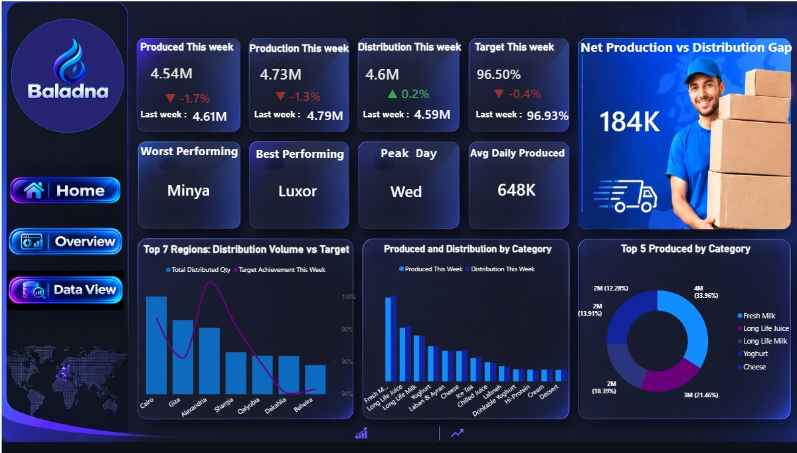
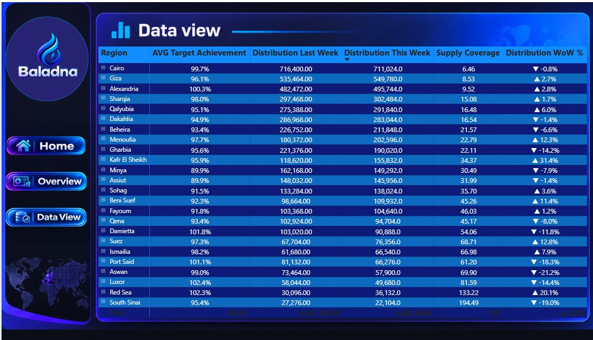

# Baladna Supply Chain Dashboard

An interactive Power BI report that tracks weekly production against distribution for an Egyptian dairy and food company, across regions and product categories. It is built to answer one question quickly: **are we producing what we distribute, and which regions are falling behind target?**

## Dashboard pages

| Page | What it shows |
|---|---|
| **Home** | Landing page with navigation to Overview and Data View |
| **Overview** | Weekly KPIs, best/worst region, peak day, production vs distribution by category, top regions vs target |
| **Data View** | Region-level table: target achievement, distribution last week vs this week, supply coverage, week-over-week change |

## Key metrics

- **Produced / Production Pipeline / Distribution This Week**, each compared with last week (WoW %)
- **Target Achievement This Week** vs last week
- **Produced vs Distributed** gap
- **Supply Coverage** per region
- **Best / Worst Performing region**, **Peak Day**, **Average Daily Produced**

## Tools

Power BI Desktop, Power Query (M), DAX, Excel

## Data preparation (Power Query)

1. Cleaned each source table and fixed data types.
2. Appended the four product tables into one production fact table (`Fact-P`).
3. Referenced the Distribution sheet instead of duplicating it, so the cleaning steps stay in one place. This reference became the distribution fact table.
4. Removed the columns the model does not need and kept only the product code and product name.
5. Removed duplicates on the product code to build a clean product dimension.
6. Added a date table and a separate `main kpi` table that holds only measures, so the field list stays tidy.

## Data model

Star schema: two fact tables (production and distribution) connected to shared dimensions (products and date). Region comes from the distribution table..

- Fact: `Fact-P` (production), `F-Distrution` (distribution)
- Dimensions: `Dim_Products`, `Dim_Date`
- Measures table: `main kpi`

## Challenges and how I handled them

1. **Four product tables with the same structure.** Appending them into one fact table avoided four sets of visuals and kept every measure working on a single table.
2. **Duplicate product codes in the distribution sheet.** Joining on a non-unique key would multiply rows and inflate totals. Removing duplicates and building a dimension fixed the relationship to one-to-many.
3. **Two fact tables sharing dimensions.** Production and distribution cannot be related directly, so both filter through the shared product and date dimensions.
4. **Week-over-week measures.** "This week" and "last week" had to be calculated from the latest date in the data instead of today's date, otherwise the cards would go blank as time passes.
5. **Showing direction, not only numbers.** A DAX measure returns the change with an up or down arrow, and conditional colors make a drop or a rise visible without reading the number.
6. **Web-style design inside Power BI.** Custom backgrounds, transparent cards, and page navigation buttons give the report an app-like feel while staying fully interactive.

## Notes

The report is designed for a 16:9 canvas. Dataset details are not published in this repository.
